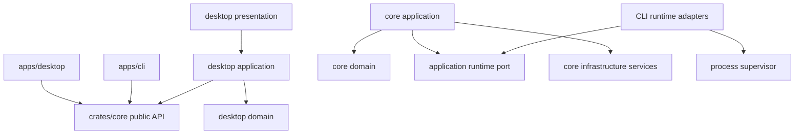

# Aucteris architecture

Aucteris is a Cargo workspace with thin application entry points and one reusable engine crate. The desktop app and CLI are clients of the same core API.

## Workspace layout

```text
apps/
  cli/                         # aucteris command-line application
  desktop/                     # GPUI desktop application
    src/
      application/             # UI-to-engine use cases and runtime selection
      domain/                  # bot, chat, message, and settings state
      infrastructure/          # local desktop persistence
      presentation/            # GPUI shell, views, theme, and embedded assets
crates/
  core/                        # aucteris-core library
    src/
      domain/                  # mission and task entities
      application/             # use cases + ports/runtime contract
      adapters/runtime/        # Claude, Codex, OpenCode, Gemini, mock adapters
      infrastructure/          # process control, store, sandbox, cgroups, egress
```

## Responsibilities

- **Domain** owns mission/task state in the engine and bot/chat state in the desktop app. Domain modules do not depend on GPUI or process I/O.
- **Application** coordinates mission execution, verification, status transitions, and reporting. `application/ports/runtime.rs` defines the harness contract. The desktop application adapter translates bot settings and prompts into core missions and maps execution events into UI events.
- **Runtime adapters** translate the stable `RuntimeAdapter` contract into each CLI's arguments, output events, and declared capabilities. The engine controls registration and mission lifecycle.
- **Agent sessions** (`apps/desktop/src/application/session.rs`) drive the desktop chats through `komet-harness`: one persistent, resumable session per chat, steered and interrupted per chat. Approvals and agent questions are bridged back into the transcript as cards, and each bot's sandbox level rides the run request. CLIs without a harness (Gemini) still run through the core mission path.
- **Infrastructure** owns JSON mission persistence, process supervision/cancellation, sandbox setup, and egress proxying.
- **Presentation** renders state and forwards user actions. It does not spawn agents or write core mission records directly.
- **Composition roots** (`apps/desktop/src/main.rs` and `apps/cli/src/main.rs`) construct the application and select the engine's built-in runtime registry.

## Dependency direction



Application and infrastructure are separate boundaries within the engine crate; the executor currently calls the crate's storage, sandbox, and process services directly. Runtime implementations remain behind the `RuntimeAdapter` port. Keep framework and provider dependencies within the relevant app or adapter layer.

Rules for future changes:

1. Keep GPUI imports inside `apps/desktop` and its presentation layer.
2. Keep provider/CLI-specific argument parsing inside runtime adapters.
3. Keep the engine callable without creating a desktop window.
4. Add new external harnesses through `RuntimeAdapter` and register them at a composition root.
5. Keep persistent desktop preferences separate from mission evidence and execution records.

## Verification commands

```bash
cargo fmt --all -- --check
cargo check --workspace --all-targets
cargo run -p aucteris-desktop
cargo run -p aucteris-cli -- run crates/core/examples/mission-slice01.yaml
```
