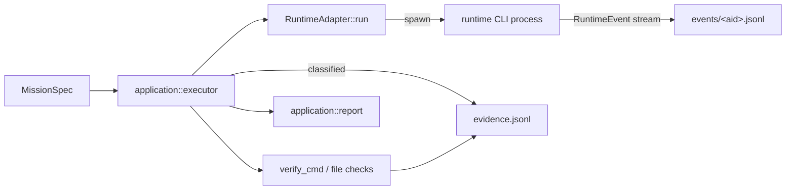

# Vertical Slice 01 — implemented mission path

**Status:** implemented (subset)
**Date:** 2026-11-20
**Related documents:** [aucteris-architecture VERTICAL-SLICE-01](https://github.com/AUCTERIS/aucteris-architecture/blob/main/docs/architecture/VERTICAL-SLICE-01.md) (the proposal this implements), [ADR-0001](../adr/0001-single-runtime-layer.md), [ADR-0003](../adr/0003-sandbox-and-isolation-levels.md)

This document maps the *implemented* slice onto the entities the code actually
has. The upstream proposal defines the ambition; this file is the contract the
`aucteris-core` crate keeps.

## 1. Mission schema

A mission is a `MissionSpec` (YAML/JSON file or programmatic) expanded into a
`Mission` + ordered `TaskSpec`s. Each task becomes a `TaskRun`; each execution
of a task is an `Attempt`.

```text
MissionSpec ──► Mission (id, status, sandbox/egress/memory/tool_approval flags)
   └── TaskSpec ──► TaskRun (task_id, latest session_id for resume)
          └── Attempt (id, runtime, status, pid, events/evidence paths)
```

Flags recorded at mission creation (absent in old files → safe defaults):
`sandbox` (engine bubblewrap), `network`/`egress` (proxy allowlist),
`memory` (MCP memory server), `tool_approval` (per-tool permission gate).

## 2. Execution flow



The executor never trusts the agent: assertions land in `evidence.jsonl` as
`AgentAssertion`, observable process facts as `RuntimeObservation`, and checks
Aucteris runs itself as `VerificationResult`. Unresolved effects stay
`Unknown` — no silent retry (aucteris-architecture 08 §5).

## 3. Statuses

| Level | Values |
|---|---|
| `MissionStatus` | `pending`, `running`, `blocked`, `completed`, `failed`, `cancelled` |
| `TaskStatus` | `pending`, `running`, `completed`, `failed`, `blocked`, `unknown`, `cancelled` |
| `AttemptStatus` | `running`, `succeeded`, `failed`, `unknown`, `cancelled` |

`unknown` is deliberate: an engine restart mid-attempt cannot establish the
external effect, so the attempt is marked `unknown` rather than retried or
declared failed.

## 4. Persistence layout

```text
<data_dir>/missions/<mission_id>/
  mission.json            # Mission + TaskRuns + Attempts
  events/<attempt_id>.jsonl   # raw runtime event stream (assertions live here)
  evidence.jsonl          # append-only Evidence records (locked append)
```

`Store` (`infrastructure/store.rs`) is a thin JSON store — explicitly *not* the
final durable design (aucteris-architecture 08 §3 stays open; Restate/Temporal
are the orchestration candidates per ADR-0003).

## 5. Evidence categories

Per aucteris-architecture 09 §2, the distinction is the product:

- `AgentAssertion` — what the agent *claims*; never trusted as fact.
- `RuntimeObservation` — what the runtime/process observably did.
- `VerificationResult` — a check Aucteris executed itself.
- `LifecycleNote` — engine lifecycle facts (recovery, cancellation).

## 6. Session resume

`TaskRun.session_id` records the harness-native session id an attempt ran
under; the next attempt passes it as `RunRequest::resume_session`. Missions on
the `HarnessMissionAdapter` path (ADR-0001) therefore resume the same agent
session across attempts and engine restarts.

## 7. Entities

`Mission`, `TaskRun`, `Attempt`, `MissionSpec`, `TaskSpec`, `Evidence` —
implemented in `crates/core/src/domain/mod.rs`. `Team`, capability tokens and
`PolicyDecision` remain stubbed per the upstream doc.
